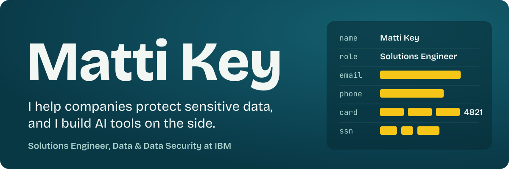
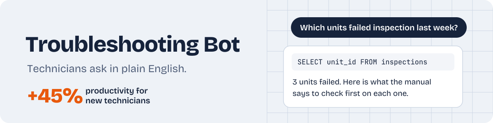
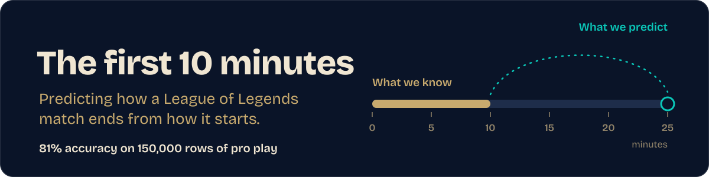

I'm a Solutions Engineer for Data & Data Security at IBM, where I specialize in helping customers protect sensitive data with Guardium. I studied machine learning, neural computation, and data science at UC San Diego, where I also rowed Division 1. 

Find me on [LinkedIn](https://www.linkedin.com/in/matti-key) or at [Email Me](mailto:keyaura3@gmail.com).

## Things I've built

**Volume** is a nightlife discovery app for San Francisco. You follow trivia crews, karaoke DJs, and other hosts as they move between venues, and a volume dial switches the feed between lively event nights and quiet spots. I designed the product, the two-sided business model, and the mobile interface, then deployed an interactive prototype. The full build is in progress with React Native (Expo), Supabase, and Stripe.

**[Troubleshooting Bot](https://github.com/keyaura3/Troubleshooting-Bot)** is a local, private RAG and text-to-SQL chatbot for aircraft technicians, built during my 2024 internship at Collins Aerospace. It improved technician productivity by 15% for experienced users and 45% for novices. The code is proprietary, so the repo holds the architecture and write-up. Built with Python, Flask, Next.js, Ollama, Docker, Databricks, a vector database, and AWS.

**[The first 10 minutes](https://github.com/keyaura3/League-Of-Legends-Analysis)** asks whether the opening of a League of Legends match predicts how a player finishes. I analyzed 150,000+ rows of 2022 professional match data with hypothesis and permutation tests, trained a random forest classifier that reached 81% accuracy, and checked that it performs evenly across player positions. Built with Python, pandas, and scikit-learn.

## More work

| Project | What it is | Tools |
| --- | --- | --- |
| [Sleep Quality Predictor](https://connieliugh.github.io/DSC106_Final_Project/) | Interactive site that predicts sleep quality from research data (team project, [code](https://github.com/CONNIELIUGH/DSC106_Final_Project)) | Python, JavaScript |
| [Supervised ML comparison](https://github.com/keyaura3/COGS-118A-FINAL-PROJECT) | Random forests, SVMs, and neural networks compared across datasets and training splits | Python, scikit-learn |
| [Dream sentiment forecasting](https://github.com/keyaura3/Dream-Valence) | Sentiment scoring and time-series forecasting on dream diaries from 94 people | Python, VADER, ARMA |
| [News network engagement](https://github.com/keyaura3/News-Engagement) | Do negative posts from news networks get more engagement? | Python, VADER, TextBlob |

## What I work with

| Area | Tools |
| --- | --- |
| Data security | IBM Guardium, DSPM, DLP, encryption, data governance |
| Cloud | AWS, Azure, Red Hat OpenShift, Docker, Linux |
| AI and data | RAG, text-to-SQL, scikit-learn, PyTorch, SQL, pandas |
| Languages | Python, SQL, JavaScript, Java |

**Certifications:** IBM Guardium Data Protection Practitioner Advanced (2026). AWS Certified Security - Specialty is in progress.
